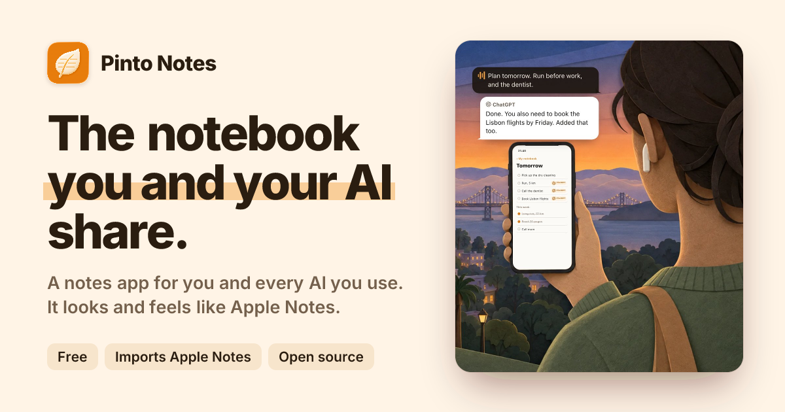
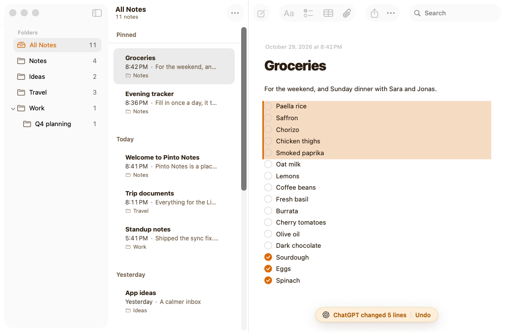
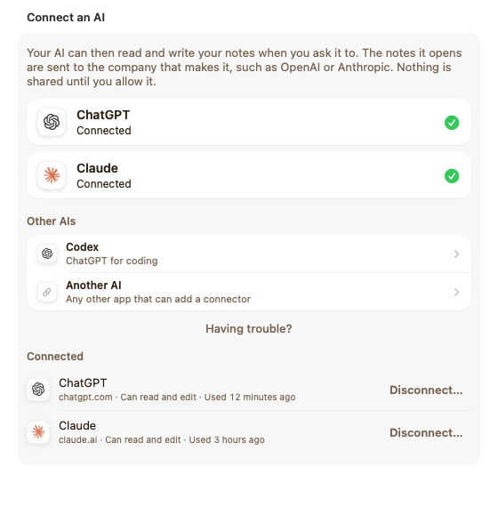
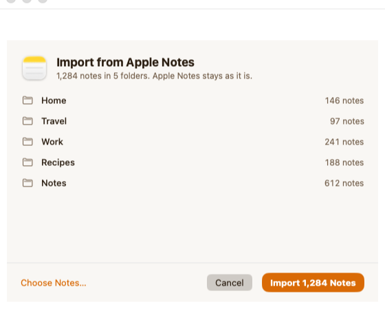
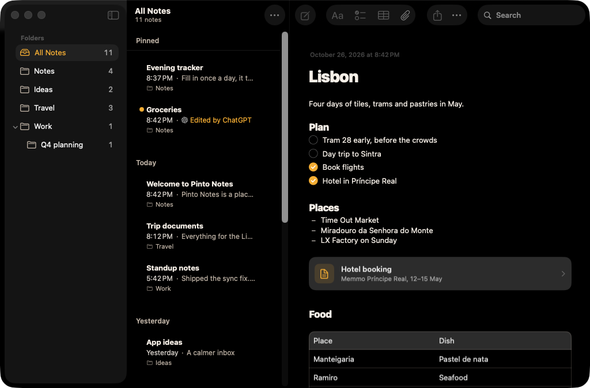

<p align="center">
  <a href="https://pintonotes.com"></a>
</p>

<p align="center">
  <a href="https://pintonotes.com/download"></a>
  <a href="https://github.com/pinto-notes/pinto-notes/releases/latest"></a>
  <a href="https://github.com/pinto-notes/pinto-notes/stargazers"></a>
</p>

<p align="center">
  <a href="https://pintonotes.com">pintonotes.com</a> &nbsp;·&nbsp; <a href="#connect-an-ai-in-a-minute">Connect an AI</a> &nbsp;·&nbsp; <a href="#contribute">Contribute</a> &nbsp;·&nbsp; iPhone app coming soon
</p>

Pinto Notes is a notes app for Mac and iPhone that ChatGPT, Claude, Claude Code and Codex can read and edit. Ask ChatGPT on your phone and Claude at your desk: both work in the same note, and every change says who made it.

<p align="center">
  
</p>

- **One notebook for every AI.** Plan a trip in ChatGPT, tick it off in Claude Code, read it on your phone a second later.
- **You see what changed, and undo it.** An AI's edits are tinted with its name. Every version is kept, with who made it.
- **Feels like Apple Notes. Brings yours over.** Folders, checklists and tables, and a one-step Apple Notes import. Evernote, Google Keep, Obsidian, Notion and Bear exports come along too.
- **A note can be an app.** Ask your AI to turn a note into a habit tracker or a budget. The text stays underneath.
- **Encrypted, free and open source.** Notes are sealed on your devices before upload, and Advanced protection makes them end-to-end encrypted. MIT licensed, no ads, no tracking.

<table align="center">
  <tr>
    <td></td>
    <td></td>
  </tr>
</table>

## Connect an AI in a minute

1. [Download the Mac app](https://pintonotes.com/download) and sign in with Apple or email.
2. Add the server to your AI:

   **ChatGPT or Claude:** add a custom connector with the address `https://mcp.pintonotes.com`.

   **Claude Code:**
   ```sh
   claude mcp add --scope user --transport http pinto-notes https://mcp.pintonotes.com
   ```
   Or install the plugin, which adds a skill that tells Claude how your notes are laid out:
   ```sh
   claude plugin marketplace add pinto-notes/pinto-notes
   claude plugin install amber-notes
   ```

   **Codex:**
   ```sh
   codex mcp add pinto-notes --url https://mcp.pintonotes.com
   ```

   **Gemini CLI:**
   ```sh
   gemini extensions install https://github.com/pinto-notes/pinto-notes
   ```

   **Any other MCP client:** Streamable HTTP at `https://mcp.pintonotes.com`, OAuth 2.1.
3. Approve the connection when Pinto Notes asks.

Then try "find my Lisbon note and add a day in Sintra". (The plugin keeps its old id, `amber-notes`, so existing installs keep working.)

<p align="center">
  
</p>

## Contribute

Pinto Notes is built in the open, and small pull requests are very welcome. Every issue below says where the code lives, how to test it and when it's done. Comment on one to claim it, and you'll get a first review within two days.

| Issue | Language | Size |
|---|---|---|
| [Write a template for the gallery](https://github.com/pinto-notes/pinto-notes/issues/136) | JSON, no Swift needed | S |
| [Import Bear backups](https://github.com/pinto-notes/pinto-notes/issues/139) | Swift | S |
| [Add unit tests for four markdown helpers](https://github.com/pinto-notes/pinto-notes/issues/84) | TypeScript | S |
| [Run every server test with one script](https://github.com/pinto-notes/pinto-notes/issues/91) | Shell | S |
| [Let `qa-test.sh` widen timing budgets on a busy Mac](https://github.com/pinto-notes/pinto-notes/issues/76) | Shell | S |
| [Import from Day One](https://github.com/pinto-notes/pinto-notes/issues/134) | Swift | M |
| [Import Notion databases as tables](https://github.com/pinto-notes/pinto-notes/issues/133) | Swift | M |
| [Translate the app, starting with Swedish](https://github.com/pinto-notes/pinto-notes/issues/135) | Swift | L |

Setup takes about 10 minutes: see [CONTRIBUTING.md](CONTRIBUTING.md). Have an idea of your own? Post it in [Discussions](https://github.com/pinto-notes/pinto-notes/discussions/categories/ideas).

### Thanks

Everyone who has had a pull request merged, in the order they joined:

- [@wufangyong973](https://github.com/wufangyong973): brought the website's README up to date ([#97](https://github.com/pinto-notes/pinto-notes/pull/97))
- [@arnavtambe](https://github.com/arnavtambe): removed an unused field from the app's connections ([#109](https://github.com/pinto-notes/pinto-notes/pull/109))
- [@sameer-dhande](https://github.com/sameer-dhande): made each help answer announce its own question to screen readers ([#170](https://github.com/pinto-notes/pinto-notes/pull/170)), named the table's row and column handles for VoiceOver ([#176](https://github.com/pinto-notes/pinto-notes/pull/176)), made the trend chart count answers the way the grid does ([#622](https://github.com/pinto-notes/pinto-notes/pull/622)) and added the Create note and Add to note Shortcuts actions ([#623](https://github.com/pinto-notes/pinto-notes/pull/623))

New versions ship most days: [Releases](https://github.com/pinto-notes/pinto-notes/releases) · [changelog](https://pintonotes.com/changelog).

## Features in detail

<details>
<summary>Everything the app does today</summary>

- **Apple Notes layout and behaviour.** Folders, a note list grouped by date, pinning, search, multi-select, Recently Deleted.
- **Markdown underneath, formatted on screen.** Headings, bold, italic, underline, strikethrough, code, quotes, links. The markdown syntax stays out of sight.
- **Lists like Notes.** Checklists (ticked items slide to the bottom), bulleted (`*`), dashed (`-`) and numbered lists. Return continues a list, Tab nests it.
- **Tables** you edit cell by cell, with typed columns (dates, numbers, choices, 1 to 10 scales) and a trend chart.
- **Sub-notes.** Link a note inside another, like a folder inside a page.
- **Files and images** inside a note: paste, drag in, or attach. PDFs open in Quick Look.
- **Live sync.** Typing on one device shows up on the others in about half a second. Edits made on two devices at once are never silently lost.
- **Version history.** Every change keeps the previous version, with who made it: you on iPhone, you on Mac, or which AI.
- **Share a note as a web page** with a private link, and stop sharing at any time.
- **Shortcuts and Siri.** Create a note, add to a note (at the end or under a heading), read a note.
- **AI access over MCP.** ChatGPT, Claude, Claude Code, Codex, Gemini CLI or any MCP client. You approve every connection inside the app, and every change an assistant makes keeps the previous version.
- **Apple Notes import** on the Mac, and a menu bar item for quick capture.
- **Evernote import.** Each exported notebook (.enex) becomes a folder, with checklists, tables, images, PDFs, dates and tags kept. Importing the same export again skips what's already here.
- **Google Keep import.** From a Google Takeout download: text and checklists, labels as folders or tags, pins, dates and images. Archived notes come only if you ask, into an Archive folder.
- **Markdown or text import.** A folder or .zip from Obsidian, Notion, Bear, Joplin, Logseq, Simplenote or Standard Notes: subfolders become folders, linked images and files come along, front-matter dates and tags are kept, and [[wiki links]] keep leading to the notes they name.
- **Private by default.** Sign in with Apple or email. No ads and no tracking. The app sends error reports and a few usage counts, never your notes, and one switch turns that off ([what it sends](docs/Technical/app-telemetry.md)); the website counts visits without cookies. Delete your account from Settings.

</details>

## Privacy and security

- **Encryption.** Each account has one random 256-bit key, made on your first device and kept as a synced Keychain item, so iCloud Keychain carries it to your other iPhone or Mac. Note bodies, titles, folder names, files and old versions are sealed with AES-256-GCM before upload. By default the server also keeps a copy of the key, sealed under a secret that is not in the database, so that signing in opens the notes on a new device. That means Pinto Notes could open a standard account's notes if it had to, for example under a court order, and so could someone who gets into the account. Advanced protection, in Settings, Security, deletes that copy, and the notes are then end-to-end encrypted ([how it works, and who can read what](docs/Technical/recoverable-key.md)).
- **AI connections.** When you approve an AI, the app wraps your key under the OAuth authorization code; at the token exchange it is rewrapped under the access and refresh tokens, and the server keeps only token hashes. Disconnecting deletes the wrap.
- **The honest limit.** During an AI request the server decrypts the notes that request needs, in memory. Notes you lock with the notes password stay out of reach, because that key isn't on the server. Dates, sizes, folder structure and which notes are locked stay readable. With Advanced protection on, if you lose every device and the recovery key, nobody can open the notes.
- Row-level security applies to the app, the AI server and direct API calls alike, on top of the encryption. AI tokens are stored as hashes.
- Shared pages are public to anyone with the link. The app warns before creating one, and a page stops working the moment you stop sharing.
- The full design: [docs/Technical/e2ee-design.md](docs/Technical/e2ee-design.md) · [Privacy policy](https://pintonotes.com/privacy) · [Security policy](SECURITY.md)

## How it's built

| Part | Where | What |
|---|---|---|
| App | `Pane/` | SwiftUI for iOS 26 and macOS 26. The editor is TextKit 2 with its own layout fragments for checkboxes, bullets, tables and embeds. SwiftData holds a local copy of everything. |
| Sync | `Pane/Sync/` | Pushes and pulls through Supabase with version checks, and listens on Supabase Realtime for changes from other devices. |
| Backend | `supabase/` | Postgres with row-level security on every table, per-account limits and rate limits in the database, Storage for files, and Edge Functions. |
| AI server | `supabase/functions/mcp/` | An MCP server (Streamable HTTP) with 12 file-like tools (`files_tools.ts`). Public address `https://mcp.pintonotes.com`, proxied by the site (`web/middleware.ts`); the older `https://mcp.ambernotes.app` is the same server and keeps working. Web clients connect with OAuth 2.1 (PKCE, dynamic client registration). Claude Code and Codex use a revocable header token. Every call runs as the note owner with row-level security. |
| Site | `web/` | Next.js: pintonotes.com, shared notes (sanitized markdown, strict CSP), the connect pages. |
| Share extension | `PaneShare/` | Share sheet target on iOS. |

Folder and target names still say "Pane", the app's working name. The Xcode project is generated from `project.yml` with [XcodeGen](https://github.com/yonaskolb/XcodeGen).

<details>
<summary><b>Build from source</b></summary>

You need macOS 26 with Xcode 26, Homebrew, and Docker (for the local Supabase stack). A fresh clone runs entirely on your machine.

```sh
git clone --filter=blob:none https://github.com/pinto-notes/pinto-notes.git
cd pinto-notes
scripts/setup.sh          # installs XcodeGen and the Supabase CLI, starts the local stack, builds the Mac app
open Pane.xcodeproj       # run the "Pane" scheme on "My Mac" or an iPhone simulator
```

`scripts/setup.sh` finds Xcode on its own. For your own `xcodebuild` commands, either run `sudo xcode-select -s /Applications/Xcode.app` once or put `DEVELOPER_DIR=/Applications/Xcode.app/Contents/Developer` in front of them; otherwise they fail with `tool 'xcodebuild' requires Xcode`. The built app is `build/ddqa/Build/Products/Debug/Pane.app`, the same build `scripts/qa-test.sh` uses.

The app talks to the local stack through `Config/Backend.xcconfig`, which carries Supabase's standard local-only development key. To point your builds at a real project, create `Config/Backend.local.xcconfig` (gitignored) with your own `PANE_SUPABASE_URL`, `PANE_SUPABASE_KEY` and `PANE_SHARE_URL`.

The Mac app and the iPhone Simulator build with no Apple account. For your own bundle id, name and team (a free Apple account puts it on your iPhone), run `scripts/make-it-yours.sh`: see [Make it yours](#make-it-yours).

**Tests**

```sh
scripts/qa-test.sh --smoke                           # a first check, about a minute after setup.sh
scripts/qa-test.sh                                   # every Mac unit and interaction test, 20 to 30 minutes
scripts/prepush.sh --tests                           # before a push: compiles what ships, runs the suites you touched
deno test --allow-all supabase/functions/mcp/notes.test.ts
scripts/mcp-e2e.sh                                   # MCP end-to-end, against the local stack
scripts/share-e2e.sh                                 # share links end-to-end, against the local stack
(cd web && pnpm install && pnpm test && pnpm build)  # the site
```

The interaction tests drive the real editor in an offscreen window, so they never move your mouse or take focus.

</details>

<details>
<summary><b>Run your own backend</b></summary>

Everything the app needs runs on one Supabase project:

1. Create a project at [supabase.com](https://supabase.com) and put a personal access token in `.env` as `SUPABASE_ACCESS_TOKEN=sbp_…`.
2. Run `scripts/deploy-backend.sh <project-ref> --dry-run` to see the steps, then without `--dry-run`. It links the project, applies the migrations, deploys the functions and their secrets, sets up email sign-in with a code, and writes `Config/Backend.local.xcconfig`.
3. For share links and connecting ChatGPT or Claude, deploy `web/` to any Next.js host and run the script again with `--site https://your-site`.

</details>

## Make it yours

Clone it, build your own copy and change it however you like, by hand or with Claude Code or Codex. No paid Apple account needed: you need macOS 26, Xcode 26, Homebrew and, for sign-in and sync, Docker Desktop.

```sh
git clone --filter=blob:none https://github.com/pinto-notes/pinto-notes.git
cd pinto-notes
scripts/setup.sh
```

`scripts/setup.sh` checks your Mac, starts a local backend, builds the Mac app under a name and bundle id of its own, and prints the `open` line for it: 5 to 20 minutes the first time, most of it downloads. Without Docker, `scripts/setup.sh --local-only` builds an app that keeps notes on this Mac. [docs/MAKE-IT-YOURS.md](docs/MAKE-IT-YOURS.md) has the rest: what you see the first time, your own name and icon, your iPhone, your own backend, where the colours and toolbar live, prompts for coding agents, and pulling updates with few conflicts.

## License

[MIT](LICENSE). Made by Emil Wagman at [Incredible](https://incredible.one). Formerly Amber Notes.
